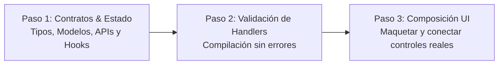

# OKF-C1: Constitución Técnica de Desarrollo (Anti-Broken Buttons & Token Gating)
> **Formato:** Open Knowledge Format (OKF) v1.0  
> **Ámbito:** Reglas Inquebrantables de Ingeniería y Comportamiento  

---

## 1. Declaración Constitucional
Todo componente, archivo o script generado en este proyecto debe ser **100% funcional, conectado y libre de deuda técnica o código simulado**.

---

## 2. Regla 1: Prohibición Total de Elementos UI "Vacíos" (Anti-Broken Buttons)
1. **Prácticas Estrictamente Prohibidas**:
   - Callbacks vacíos: `onClick={() => {}}`, `onSubmit={() => null}`.
   - Mocks de depuración: `onClick={() => console.log('...')}`.
   - Implementaciones diferidas: `// TODO: implement`, `alert("Próximamente")`.
2. **Invariante de Renderizado**:
   - Si una acción, función, mutación, hook de estado o endpoint backend **no existe o no está implementado**, **QUEDA PROHIBIDO RENDERIZAR EL ELEMENTO VISUAL** (botón, input, switch, modal, formulario).
   - Solo se expondrán en la interfaz controles que cuenten con un servicio o handler existente, validado y funcional.

---

## 3. Regla 2: Orden de Ejecución Obligatorio (Lógica Antes que Vista)
El desarrollo de cualquier funcionalidad frontend/full-stack debe seguir estrictamente este flujo secuencial:

1. **Paso 1 - Contratos y Estado**: Definir tipos/interfaces TypeScript, modelos de datos, endpoints o clientes de API y lógica de estado/hooks.
2. **Paso 2 - Validación de Handlers**: Validar imports y verificar que los handlers y mutaciones compilen sin errores de tipo ni identificadores huérfanos.
3. **Paso 3 - Composición de UI**: Maquetar los componentes visuales y conectar exclusivamente los handlers verificados en el Paso 2. Si el alcance excede el contexto actual, entregar únicamente las funciones completas y listar el backlog restante sin renderizar controles rotos.

---

## 4. Regla 3: Optimización Máxima de Tokens y Gating Técnico
1. **Cero Relleno Conversacional**: Sin saludos superfluos, sin introducciones vacías, sin explicaciones teóricas no solicitadas y sin duplicar bloques de código no modificados.
2. **Entregables Directos**: Priorizar diffs unificados, archivos finales concretos y comandos de terminal ejecutables.
3. **Dry-Run Gating de 3 Puntos**: Para tareas extensas o modificaciones complejas, presentar primero un plan técnico resumido:
   - **Estado / Contratos**: Qué tipos y lógica se definirán.
   - **Handlers**: Qué funciones se implementarán.
   - **UI**: Qué componentes finales se renderizarán y cablearán.
